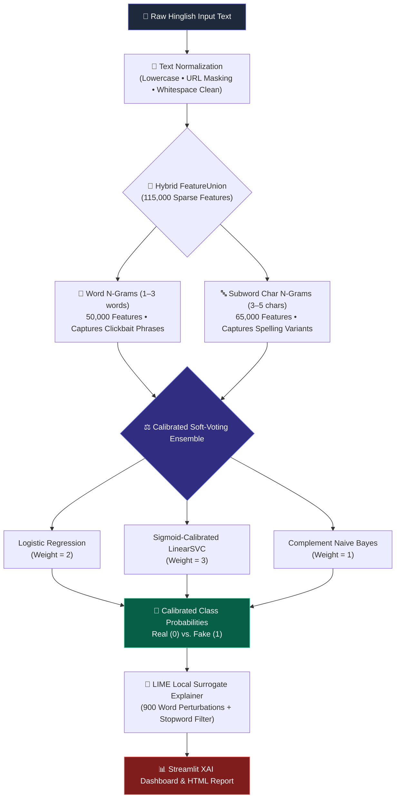

# 🛡️ Hinglish Fake News Detector + LIME XAI

**Explainable AI (XAI) for uncovering misinformation in Romanized Hindi–English code-mixed news & social media forwards.**

[](https://miniproject-5thsem.streamlit.app/)
[](https://www.python.org/)
[](https://scikit-learn.org/)
[](https://github.com/marcotcr/lime)
[](#-benchmarks--evaluation)

[🌐 Live Web App](https://miniproject-5thsem.streamlit.app/) •
[✨ Why It Stands Out](#-why-this-project-stands-out) •
[🔍 Visual LIME Demo](#-how-lime-explains-predictions-visual-preview) •
[🧠 Architecture](#-system-architecture) •
[📊 Benchmarks](#-benchmarks--evaluation) •
[🚀 Run Locally](#-run-locally)

> [!TIP]
> **🚀 Try the Live Interactive Demo — Zero Setup Required!**
> Test custom Hinglish headlines, explore 1-click viral hoax presets, and generate real-time LIME word-level explanations directly in your browser:
> 👉 **[https://miniproject-5thsem.streamlit.app/](https://miniproject-5thsem.streamlit.app/)**

---

## 🌟 Why This Project Stands Out

In India, millions of viral WhatsApp forwards and social media posts are written in **Hinglish** (Hindi typed in the Roman alphabet). Automated fact-checking in Hinglish faces two major roadblocks:

1. **No Standardized Spelling:** The same Hindi word is spelled dozens of ways online (*sarkar* vs. *sarkaar*, *kyonki* vs. *kyonk*, *shasan* vs. *shashan*), causing standard word-level NLP models to miss critical signals.
2. **The "Black-Box" Trust Deficit:** Telling a user *"This message is 91% Fake"* without highlighting **why** fails to build user trust.

> [!IMPORTANT]
> **Our Solution:** Instead of relying on heavy, opaque 1 GB+ transformer models that require GPUs, we built a **~22 MB Subword-Aware Calibrated Soft-Voting Ensemble** paired with **LIME (Local Interpretable Model-agnostic Explanations)**. It infers in **<5 ms on CPU**, achieves **0.9244 ROC-AUC**, and highlights the exact Hinglish trigger words behind every verdict.

---

## 🔍 How LIME Explains Predictions (Visual Preview)

When you enter a Hinglish headline on the [Live Web App](https://miniproject-5thsem.streamlit.app/), LIME perturbs the sentence across **900 local variations**, queries our ensemble's calibrated `predict_proba()`, filters out grammatical Hinglish fillers (*hai, ke, ki, mein, aur*), and highlights influential tokens:

### 🚨 Example 1: Viral WhatsApp Hoax
**Input:**
> *"breaking news rbi ne aaj raat se sabhi 500 ke note band karne ka aadesh jari kiya hai forward karein"*

**Verdict:** `🚨 FAKE NEWS (94.18% Confidence)`

| Token | LIME Weight | Influence Direction |
| :--- | :---: | :--- |
| `breaking` | `+0.1842` | 🔴 Pushes toward **Fake News** |
| `band` | `+0.1510` | 🔴 Pushes toward **Fake News** |
| `forward` | `+0.1435` | 🔴 Pushes toward **Fake News** |
| `note` | `+0.0980` | 🔴 Pushes toward **Fake News** |
| `rbi` | `-0.0312` | 🟢 Pushes toward **Real News** |

---

### ✅ Example 2: Factual Sports News
**Input:**
> *"bharat aur australia ke beech test series ka agla mukabla guruwar se khela jayega team india taiyar"*

**Verdict:** `✅ REAL NEWS (91.64% Confidence)`

| Token | LIME Weight | Influence Direction |
| :--- | :---: | :--- |
| `series` | `-0.1620` | 🟢 Pushes toward **Real News** |
| `test` | `-0.1485` | 🟢 Pushes toward **Real News** |
| `australia` | `-0.1290` | 🟢 Pushes toward **Real News** |
| `mukabla` | `-0.0940` | 🟢 Pushes toward **Real News** |
| `team` | `-0.0715` | 🟢 Pushes toward **Real News** |

---

## 🧠 System Architecture



### 💡 Key Engineering Decisions
* **Dual Word + Character TF-IDF (`115k` features):** Word 1–3 n-grams catch multi-word traps (*free laptop*, *link par click*), while `char_wb` 3–5 character n-grams match shared phonetic roots across inconsistent Romanized spellings.
* **Smooth Probability Calibration for LIME:** Raw SVMs lack `predict_proba()`, and tree models produce step-function probabilities that destabilize LIME's local ridge regression. Combining `LogisticRegression`, `CalibratedClassifierCV(LinearSVC)`, and `ComplementNB` produces smooth probability gradients.
* **Filler-Aware Explanation Filtering:** Grammatical postpositions (*hai, hain, ke, ka, ki, mein, se, aur*) remain visible to the classifier for sentence structure, but are stripped from the LIME attribution chart so users only see meaningful content words.

---

## 📊 Benchmarks & Evaluation

Trained and evaluated on **`hinglish-fake-news-dataset-final-cleaned-v2_2.csv`** (**16,843 unique deduplicated records**: `9,825` Real News | `7,018` Fake News) using an 80/20 stratified split (`3,369` held-out test samples).

| Metric | Score | Significance |
| :--- | :---: | :--- |
| **Test Accuracy** | **85.72%** | Overall classification accuracy on unseen Hinglish news |
| **Macro F1-Score** | **0.8514** | Balanced harmonic mean across both Real (`0`) and Fake (`1`) classes |
| **ROC-AUC Score** | **0.9244** | High probability calibration quality (crucial for LIME fidelity) |
| **CPU Inference Latency** | **< 5 ms** | Enables real-time 900-sample LIME explanations without a GPU |

<details>
<summary><b>📋 View Detailed Classification Report & Confusion Matrix</b></summary>
<br>

| Class | Precision | Recall | F1-Score | Support |
| :--- | :---: | :---: | :---: | :---: |
| **Real News (`0`)** | 0.86 | 0.90 | 0.88 | 1,965 |
| **Fake News (`1`)** | 0.86 | 0.79 | 0.82 | 1,404 |
| **Macro Average** | **0.86** | **0.85** | **0.85** | **3,369** |
| **Weighted Average** | **0.86** | **0.86** | **0.86** | **3,369** |

**Confusion Matrix (`3,369` Test Samples):**
* **True Real (`0 → 0`):** `1,777` | **False Fake (`0 → 1`):** `188`
* **False Real (`1 → 0`):** `293` | **True Fake (`1 → 1`):** `1,111`

</details>

<details>
<summary><b>🔬 Compare Against Prior Hinglish Fake News Research</b></summary>
<br>

| Dimension | mBERT + Metadata *(Kar et al., 2021)* | CNN / BiLSTM + Static Embeddings | XLM-RoBERTa / IndicBERT / HingBERT | **Ours (Hybrid Ensemble + LIME)** |
| :--- | :--- | :--- | :--- | :--- |
| **Core Model** | Multilingual BERT + user metadata | 1D-CNN / BiLSTM over FastText/Word2Vec | Fine-tuned code-mixed transformers | **Word + Char TF-IDF Soft-Voting Ensemble** |
| **Spelling Variants** | Moderate (noisy WordPiece splits) | Weak (high OOV rate) | Strong (requires heavy pre-training) | **Strong** (`char_wb` 3–5 phonetic roots) |
| **Explainability** | ❌ None (black-box) | ❌ None / raw attention | ❌ None / opaque self-attention | ✅ **Built-in LIME** (causal weights + HTML) |
| **Footprint & Speed** | ~680 MB (GPU required) | ~150–300 MB (GPU/PyTorch) | ~500 MB–1.1 GB (slow on CPU) | **~22 MB** (**<5 ms** CPU inference) |

</details>

---

## 🌐 Live Deployment & Local Setup

### Option A: Use the Hosted Web Application (Recommended)
Visit **[https://miniproject-5thsem.streamlit.app/](https://miniproject-5thsem.streamlit.app/)** to explore:
* **🔍 Live Detector & LIME XAI:** Test custom Hinglish headlines, use 1-click viral hoax presets, or pull a **Random Dataset Row** with ground-truth comparison.
* **📂 Batch CSV Evaluator:** Upload a CSV file of Hinglish headlines for bulk classification.
* **📊 Architecture & Viva Overview:** Inspect model KPIs, soft-voting breakdowns, and evaluation metrics.

### Option B: Run Locally on Your Machine
```bash
# 1. Clone the repository
git clone https://github.com/your-username/hinglish-fake-news-lime.git
cd hinglish-fake-news-lime

# 2. Install dependencies
pip install streamlit scikit-learn joblib lime pandas numpy

# 3. Launch the Streamlit app
streamlit run app.py
```

### CLI Inference & Model Reproduction
```bash
# Run CLI predictions and export standalone LIME HTML explanations
python predict_and_explain_lime.py

# Reproduce full model training from the cleaned dataset
python train_on_v2.py
```

---

## 📁 Repository Structure

```text
hinglish-fake-news-lime/
├── app.py                                             # Interactive Streamlit XAI web application
├── train_on_v2.py                                     # Reproducible training & evaluation pipeline
├── predict_and_explain_lime.py                        # CLI inference & LIME HTML generator
├── hinglish_fake_news_v2_model.joblib                 # Pre-trained Hybrid Ensemble (~22 MB)
├── hinglish-fake-news-dataset-final-cleaned-v2_2.csv  # Deduplicated 3-column dataset (16,843 rows)
└── README.md                                          # Project documentation
```

---

## 🗺️ Roadmap & Future Enhancements

- [x] Deduplicate corpus and engineer dual Word + Subword Character TF-IDF pipeline
- [x] Train Calibrated Soft-Voting Ensemble (`85.72%` accuracy, `0.9244` ROC-AUC)
- [x] Integrate LIME word-level attribution with Hinglish grammatical stopword filtering
- [x] Deploy live interactive web dashboard on Streamlit Cloud ([Live App](https://miniproject-5thsem.streamlit.app/))
- [ ] Add **SHAP (SHapley Additive exPlanations)** global feature importance comparison tab
- [ ] Support **Devanagari ↔ Roman Hinglish** automatic transliteration at inference time
- [ ] Package as a lightweight **FastAPI** microservice + Chrome/WhatsApp Web extension

---

## 🤝 Contributing

Contributions, issues, and feature requests are welcome! Feel free to fork this repository, open an issue, or submit a pull request if you'd like to expand the Hinglish stopword lexicon or benchmark additional explainability methods.